# RetailFlow 360: SQL Data Warehouse

A SQL Server data warehouse that turns raw CRM and ERP CSV extracts into validated customer, product and sales data, organized in Bronze, Silver and Gold layers, with SQL analytics on top. The focus is on trustworthy data: every cleaning rule is profiled first, counted, documented and checked, and every known problem stays visible instead of being quietly fixed.

> Built with the Medallion (Bronze, Silver, Gold) pattern and a CRM + ERP retail dataset from a data-engineering course. The architecture and dataset follow the course; the local environment, Python runners, profiling, data-quality rules, transactional refresh, audits and analytics notes are my own work. See [attribution](#attribution-and-scope).

## At a glance

| | |
|---|---|
| **Sources** | 6 CSV files from two systems: CRM (customers, products, sales) and ERP (customer demographics, locations, product categories) |
| **Volume** | 116,294 source rows loaded into Bronze; 116,284 rows in Silver after cleaning |
| **Gold** | Star schema as SQL views: **18,484 customers**, **295 products**, **60,398 sales lines** |
| **Stack** | SQL Server 2022 (Docker), T-SQL, Python 3 (standard library for the pipeline, Matplotlib for charts), VS Code, Git |
| **Reliability** | Transactional Silver refresh with all quality gates inside the transaction; two committed refreshes and two forced-failure rollback tests passed |
| **Analytics** | Exploration, magnitude, ranking, change-over-time, cumulative and performance analyses over the Gold views |

## The problem

Retail data arrives from separate operational systems that describe the same customers and products differently. In this dataset:

- Customer IDs differ between CRM (`cst_id`, `cst_key`) and ERP (`cid`, sometimes with an `NAS` prefix or hyphens).
- Dates are stored as integers (`20130115`), some as `0` or malformed numbers.
- Product history is stored as versions with overlapping or reversed date ranges.
- Genders, countries and marital statuses use different codes in each system.
- The same customer can appear more than once, or without an ID.

Analysts cannot answer "how much did we sell, to whom, in which category?" until these are reconciled into one trusted model, and they need to know where it was impossible to reconcile.

## Architecture

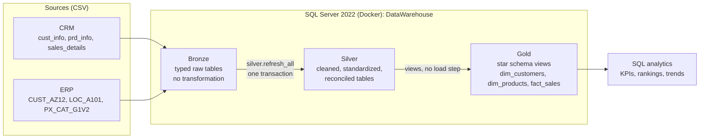

| Layer | Object type | Load | Transformations | Model |
|---|---|---|---|---|
| **Bronze** | Tables | Full load, truncate and insert; CSV parsed and verified row by row | None; types only | As-is source |
| **Silver** | Tables | Full refresh in a single transaction | Cleansing, standardization, normalization, derived columns, enrichment | As-is source, cleaned |
| **Gold** | Views | None (computed on read) | Integration of CRM and ERP, business rules | Star schema |

### Data flow (lineage)

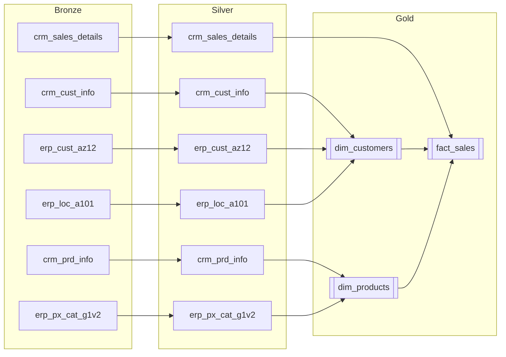

## Data integration: how the two systems connect

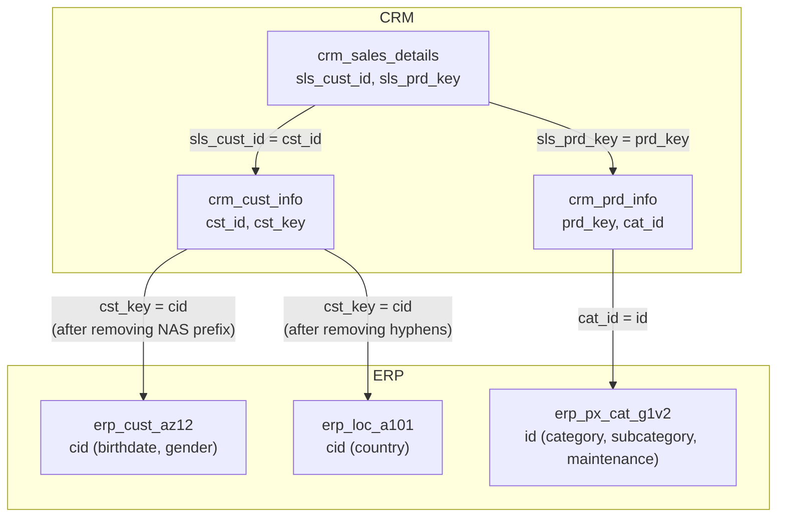

CRM is the backbone for customers, products and sales. ERP only enriches: demographics and location for customers, and category hierarchy for products. Joins from CRM to ERP are `LEFT JOIN`s, so a missing ERP record can never silently drop a customer or product.

## Bronze: ingest exactly what the source says

- A Python runner parses each CSV (UTF-8, quoting, header-order validation) and writes UTF-16 bulk files to an ignored folder, so original files are never touched and Unicode survives SQL Server on Linux.
- One transaction loads all initially empty tables; any import error or count mismatch rolls everything back.
- After loading, every row is compared back against the source as a **full row multiset** (values and duplicate counts), plus first and last records.
- A rerun skips populated tables and still validates them. Nothing is cleaned in Bronze.

| Table | Source rows | Loaded | Validation |
|---|---:|---:|---|
| `crm_cust_info` | 18,494 | 18,494 | Exact match |
| `crm_prd_info` | 397 | 397 | Exact match |
| `crm_sales_details` | 60,398 | 60,398 | Exact match |
| `erp_cust_az12` | 18,484 | 18,484 | Exact match |
| `erp_loc_a101` | 18,484 | 18,484 | Exact match |
| `erp_px_cat_g1v2` | 37 | 37 | Exact match |
| **Total** | **116,294** | **116,294** | |

## Silver: clean, standardize, reconcile

Each rule was **profiled first**, then written as set-based T-SQL, and its affected row count recorded. Rules that cannot be resolved from the data stop the load rather than guess.

### CRM customers: 18,494 to 18,484

- 4 rows with a NULL customer ID are excluded.
- 5 repeated IDs (6 excess rows) are consolidated by keeping the latest creation date, with deterministic tie-breakers so the result does not depend on row order.
- Marital status `S/M` becomes Single/Married and gender `F/M` becomes Female/Male; anything else becomes `n/a`.
- Reconciliation: 18,494 - 4 - 6 = 18,484.

### CRM products: 397 versions, 295 current

- Each raw product key is split into a category ID (the first five characters, with the hyphen replaced by an underscore) and the product key itself, so it can join to the ERP category table.
- Every historical version is kept. End dates are derived as one day before the next version's start; the last version stays open.
- **200 reversed date ranges** in the source were repaired this way, giving 102 closed versions and 295 open (current) versions.
- Product line codes `M/R/S/T` become Mountain, Road, Other Sales and Touring; two NULL costs become 0 (flagged as an assumption).

### CRM sales: all 60,398 rows kept

| Rule | Rows affected |
|---|---:|
| Integer `YYYYMMDD` converted to `DATE`, requiring exactly eight digits (a plain `TRY_CONVERT` would read `5489` as a year) | 60,398 |
| Zero order-date sentinel set to NULL | 17 |
| Malformed short order dates set to NULL | 2 |
| Sales amount rebuilt as quantity x price where inconsistent | 23 |
| Missing or negative price derived as sales / quantity (exact quotients only, no `ABS()`) | 12 |
| Rows excluded or deduplicated | 0 |

The monetary rule is an explicit, evidence-backed business assumption (gross line sales = quantity x unit price), supported by same-product peers. It is recorded as needing business confirmation, not presented as fact.

### ERP: 37,005 rows kept, identifiers normalized

- `NAS` prefix removed from customer IDs (11,042 changed) and hyphens removed from location IDs (18,484 changed), so **all 18,484 match CRM** in both directions.
- 16 birthdates in the future set to NULL; 22 birthdates over 100 years old are **retained** and flagged for review.
- Country codes standardized (`DE` to Germany, `US/USA` to United States, blank to `n/a`); 4,994 values changed.

### Silver results

| Table | Bronze | Silver |
|---|---:|---:|
| `crm_cust_info` | 18,494 | 18,484 |
| `crm_prd_info` | 397 | 397 |
| `crm_sales_details` | 60,398 | 60,398 |
| `erp_cust_az12` | 18,484 | 18,484 |
| `erp_loc_a101` | 18,484 | 18,484 |
| `erp_px_cat_g1v2` | 37 | 37 |
| **Total** | **116,294** | **116,284** |

## Reliability: transactional full refresh

`silver.refresh_all` reloads all six Silver tables inside **one transaction**:

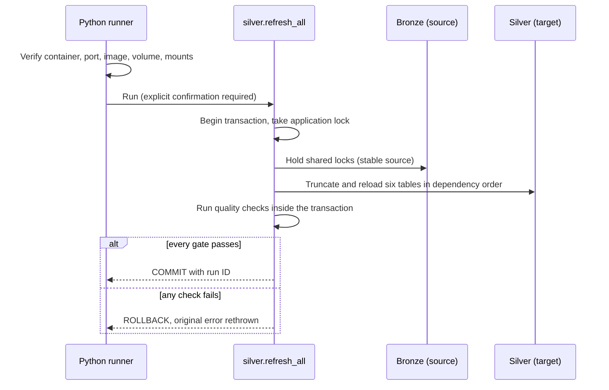

- The procedure is **generated** from the reviewed loaders and quality scripts by `build.py`, with source hashes in its header. `build.py --check` detects stale output.
- Preview is the default; destructive modes need an explicit confirmation flag.
- **Acceptance test:** two committed refreshes, plus two deliberately failed refreshes that each restored all six tables and their timestamps exactly. Bronze fingerprints stayed unchanged throughout.

## Gold: star schema

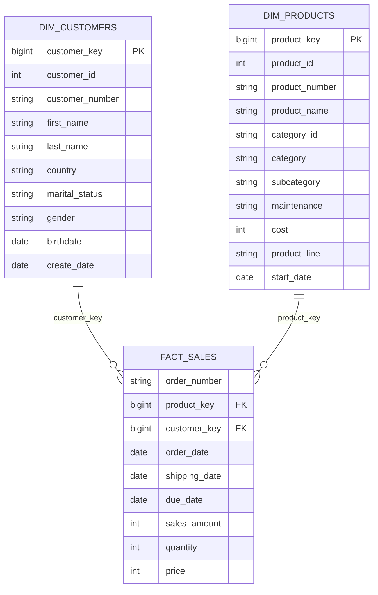

| Object | Grain | Rows |
|---|---|---:|
| `gold.dim_customers` | One CRM customer, enriched from ERP | 18,484 |
| `gold.dim_products` | One **current** product, with category from ERP | 295 |
| `gold.fact_sales` | One order line | 60,398 |

Design choices (full column contract in the [data dictionary](local-sqlserver/docs/gold/DATA_DICTIONARY.md) and [logical model](local-sqlserver/docs/gold/LOGICAL_MODEL.md)):

- **Views, not tables.** Gold is computed on read from Silver, so it can never drift from it. Surrogate keys use `ROW_NUMBER()`, which can renumber if the population changes; customer and product business IDs are kept for stable identity.
- **Gender rule:** use CRM when known, otherwise ERP, otherwise `n/a`. Result: 57 conflicts resolved CRM-first, 4,554 unknowns filled from ERP, 15 left unknown. CRM precedence is documented as an assumption.
- **Current-product perspective.** Every sale joins to exactly one current product, which keeps the full 60,398-row grain. It does not claim the product's cost or category was valid on the sale date.
- **Missing references** produce NULL keys and are reported, not dropped or replaced with invented members. Currently there are none.
- **Post-deployment checks:** unique dimension keys, zero unmatched fact keys, full sales-value reconciliation (29,356,250 total, 60,423 units), and Bronze and Silver unchanged.

## What the data says

SQL analyses run on the Gold views. These boards are static snapshots of recorded results, not a live dashboard; the source currency is not specified in the data.

**Overall KPIs**

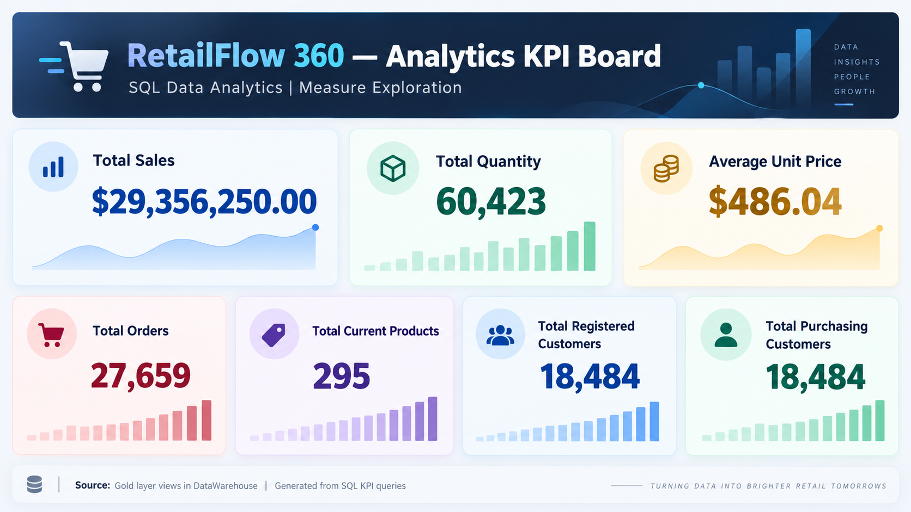

**Magnitude analysis: customers, products, sales and quantity by dimension**

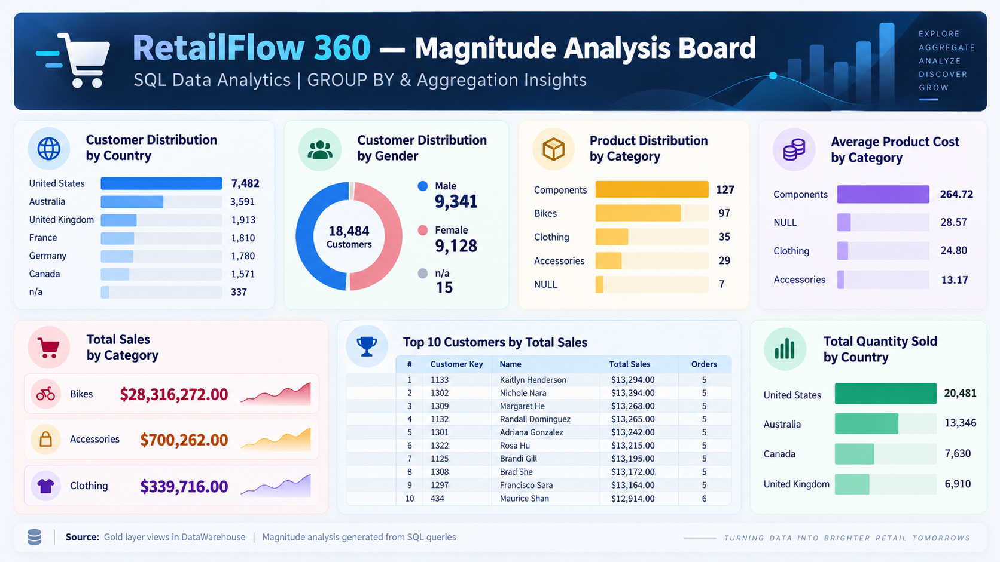

**Ranking analysis: top and bottom products, subcategories and customers**

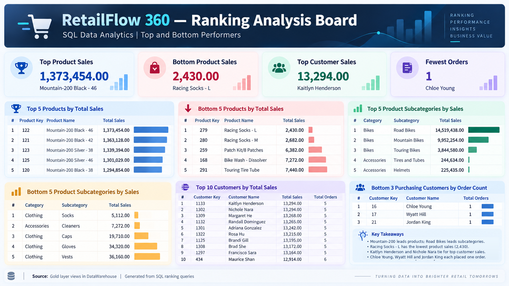

- **Total sales 29,356,250** across 27,659 orders, 60,423 units, 295 products and 18,484 customers.
- **Bikes drive revenue** (28,316,272 of the total); Road Bikes lead subcategories at 14,519,438, ahead of Mountain Bikes at 9,952,254.
- **The United States has the most customers** (7,482), followed by Australia (3,591) and the United Kingdom (1,913).
- **2013 is the peak year** (16,344,878), about 180% above 2012; December 2013 is the peak month (1,874,128). 2010 and 2014 are partial years.

Time-series work also includes running totals, moving averages and year-over-year product performance:

**Monthly sales**

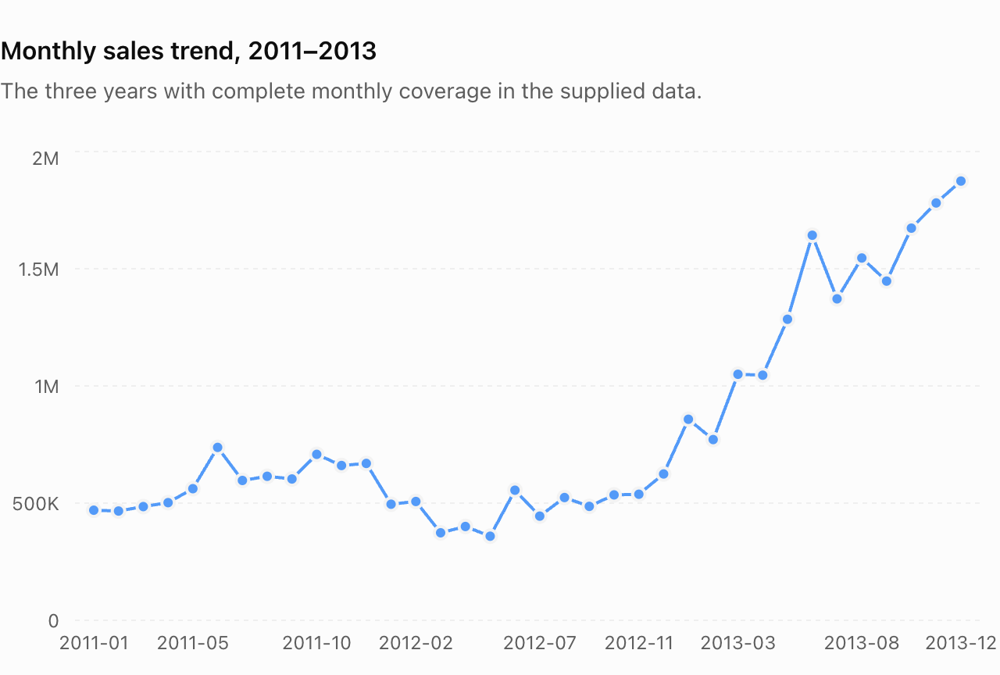

**Cumulative sales**

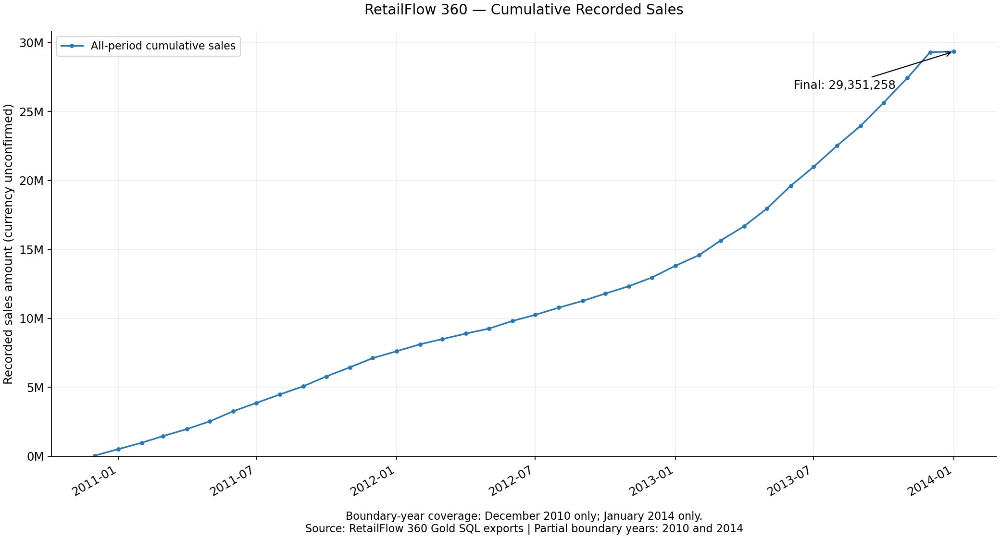

See the [analytics guide](local-sqlserver/analytics/README.md) and [advanced analytics](local-sqlserver/analytics/advanced/README.md) for the SQL, the notes explaining each technique, and the reproducible chart scripts.

## Known limitations (kept visible on purpose)

Passing quality checks does not erase business-policy questions. These are documented, not hidden:

| Issue | Size | Status |
|---|---:|---|
| Sales with unknown order date | 19 | Kept with NULL dates |
| Sales dated before the product's recorded history | 18,410 | Reported; needs a temporal attribution policy |
| Birthdates over 100 years old | 22 | Retained, flagged for review |
| CRM category `CO_PE` has no ERP match (ERP uses `CO_PD`) | 7 current products | Left NULL, no crosswalk applied |
| Monetary assumption (quantity x price) | 35 corrections | Needs business confirmation |
| Incremental loading / CDC | n/a | Not implemented; full refresh only |
| Currency | n/a | Not specified in source |

## Run it locally

Requirements: Docker, Python 3. Source CSVs are not in Git; supply the course files locally (see [local setup](local-sqlserver/docs/LOCAL_SETUP.md) for the full order including database initialization).

```bash
# start SQL Server (Docker), then from the repository root:
python3 local-sqlserver/scripts/bronze/load_bronze.py
python3 local-sqlserver/scripts/silver/run_crm.py
python3 local-sqlserver/scripts/silver/run_sales.py
python3 local-sqlserver/scripts/silver/run_erp.py

# safe preview of the transactional refresh (no data changes)
python3 local-sqlserver/scripts/silver/full_refresh/run.py preview
```

The runners verify the known container, loopback port, image, volume and read-only dataset mount before touching anything. Apple Silicon runs SQL Server under emulation, which is fine for development and not a production claim.

## Repository map

| Path | Contents |
|---|---|
| [`local-sqlserver/`](local-sqlserver/README.md) | The implemented warehouse: scripts, docs, analytics |
| [`local-sqlserver/scripts/`](local-sqlserver/scripts/) | `bronze/`, `silver/` (including `full_refresh/`) and `gold/` SQL and Python runners |
| [`local-sqlserver/docs/`](local-sqlserver/docs/IMPLEMENTATION_GUIDE.md) | Implementation and data-quality guide, setup, Gold model and data dictionary |
| [`local-sqlserver/analytics/`](local-sqlserver/analytics/README.md) | SQL lessons, notes, KPI boards, charts and chart scripts |
| [`docs/`](docs/README.md) | Reference diagrams and early planning notes |
| [`scripts/`](scripts/) | Original Azure SQL Database setup scripts (schemas and Bronze load only); see [Azure setup](docs/azure-setup.md) |

## Roadmap

- Part-to-whole, segmentation and business-report analyses.
- Interactive dashboard on top of Gold.
- An **agentic layer** (planned, not built): a read-only natural-language-to-SQL assistant over the Gold views, with guardrails and the data dictionary as its context.
- Incremental loading with change tracking, and physical Gold tables with persistent keys.

## Reference diagrams

The diagrams above are drawn from the implemented design. The original course-provided reference visuals are kept under [`docs/reference/`](docs/reference/) for comparison.

<details>
<summary>Show the course reference diagrams</summary>

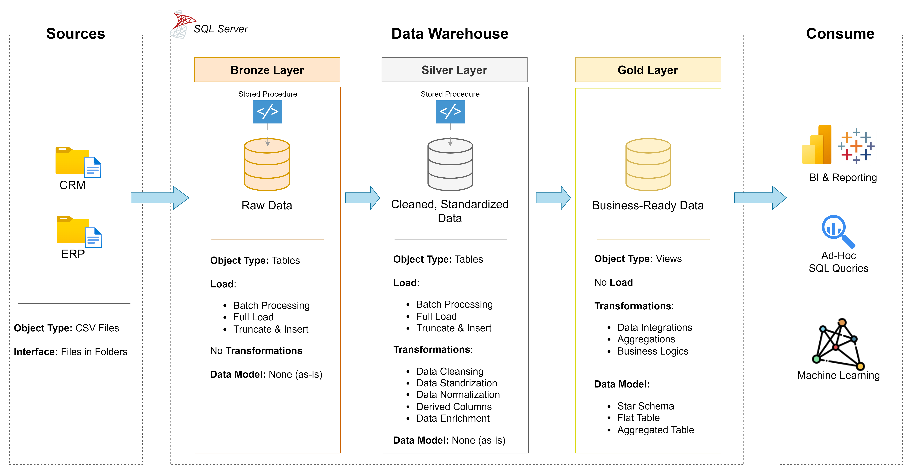
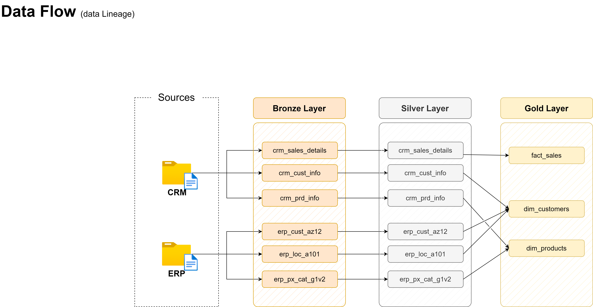
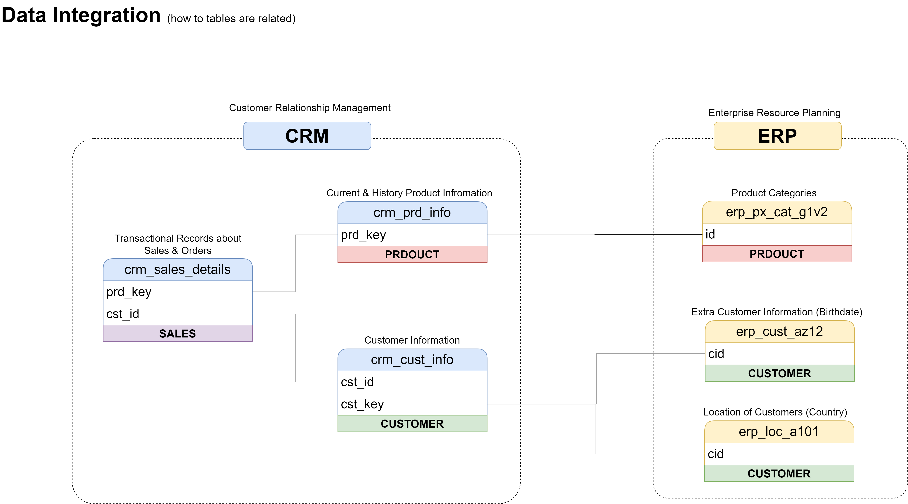
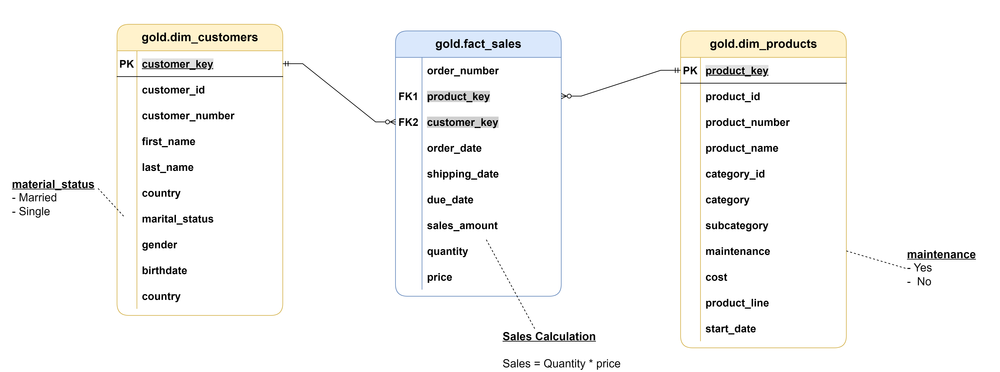

</details>

## Attribution and scope

The Medallion architecture, the CRM and ERP CSV dataset, and the reference diagrams come from a data-engineering course. The local Docker environment, Python ingestion and orchestration, profiling, data-quality rules and audits, the transactional full-refresh procedure, the Gold documentation and the SQL analytics notes were developed for this project. The dataset is sample data; no real customer information is involved.

Licensed under the [MIT License](LICENSE).
