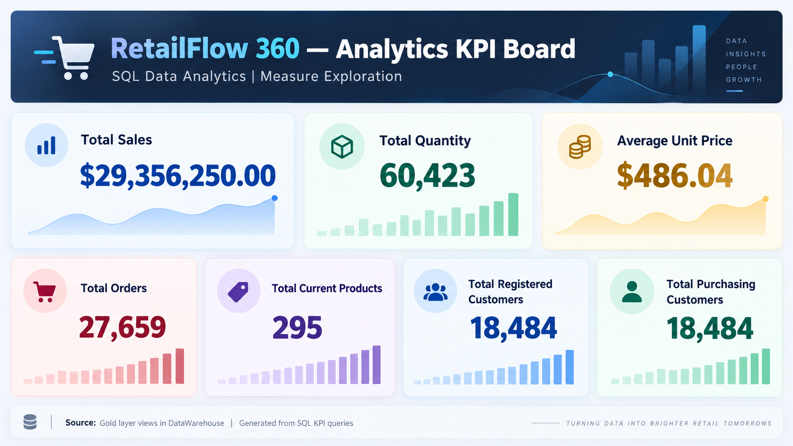
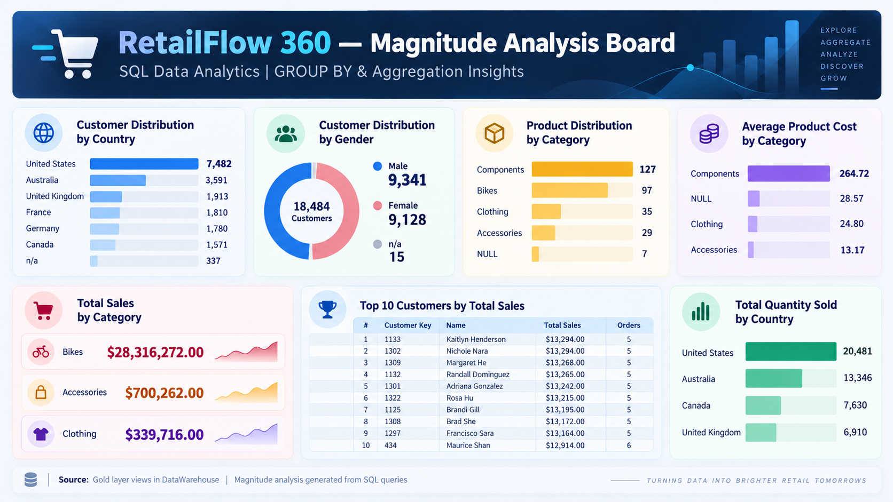
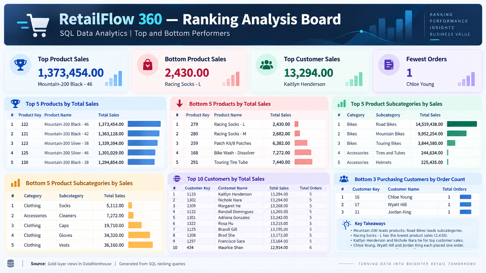

# RetailFlow 360 — SQL Analytics

This section develops SQL exploration and business analysis on the local `DataWarehouse` database. Database exploration inspects metadata; dimension exploration reads the existing Gold views. The SQL lesson files are preserved as authored, and the accompanying notes explain their concepts and known warehouse findings.

## RetailFlow 360 — Business KPI Dashboard

RetailFlow 360 uses SQL Server Gold-layer views to calculate core retail business metrics, including sales, quantity sold, order counts, product counts, and customer engagement. The KPI board presents a static summary of results from the Measure Exploration lesson.

The seven values are the project owner's recorded SQL results for the current snapshot, not newly executed results from this documentation task. **This is a static snapshot, not a live dashboard.** Decorative mini-charts are illustrative, not measured trends. Dollar symbols are unverified currency formatting; the Gold schema does not establish USD. Customer counts alone do not prove a conversion rate or engagement trend.

| KPI | Recorded SQL result |
|---|---:|
| Total Sales | 29,356,250.00 |
| Total Quantity | 60,423 |
| Average Unit Price | 486.04 |
| Total Orders | 27,659 |
| Total Current Products | 295 |
| Total Registered Customers | 18,484 |
| Total Purchasing Customers | 18,484 |

Average unit price is the unweighted arithmetic mean of recorded sales-line unit prices. Orders are distinct non-NULL order numbers, while purchasing customers are distinct non-NULL customer keys in the sales fact. Matching registered/purchasing counts do not alone establish full customer coverage.

Read the [Measure Exploration SQL](04_measure_exploration.sql) and [Measure Exploration Notes](NOTES_MEASURE_EXPLORATION.md) for definitions, grain, and interpretation.

## Magnitude Analysis — Business Insights

This board summarizes captured customer, product, sales, and quantity breakdowns from the SQL Server Gold views. It is a **static graphical snapshot**, not a live dashboard or an exhaustive view of every group.

The average-product-cost capture omits Bikes, and the quantity-by-country capture omits France, Germany, and any unknown-country group. Those figures remain follow-ups; no missing values have been invented. Decorative graphics do not establish historical trends, and dollar symbols do not verify the source currency. The notes preserve query precision where the image rounds costs.

See [05 — Magnitude Analysis SQL](05_magnitude_analysis.sql) and [Magnitude Analysis Notes](NOTES_MAGNITUDE_ANALYSIS.md) for all supplied results, grouping/join explanations, reconciliation, and limitations. The preserved SQL has a duplicate country query before its `USE` statement; select `DataWarehouse` in the client before running the entire file.

## Ranking Analysis — Top and Bottom Performers

This static ranking dashboard summarizes product, subcategory, and customer performance from captured Gold-view SQL results. Mountain-200 variants lead individual product sales; **Road Bikes leads subcategory sales at 14,519,438.00**, ahead of Mountain Bikes at 9,952,254.00. Kaitlyn Henderson and Nichole Nara tie at 13,294.00. The three displayed lowest-order purchasing customers each have one order; they are not necessarily the only customers tied at that count.

The supplied PNG already contains the corrected product-versus-subcategory takeaway. This is a portfolio snapshot, not an interactive or automatically refreshed application. Decorative graphics are not verified trends, and source currency remains unconfirmed.

Read [06 — Ranking Analysis SQL](06_ranking_analysis.sql) and [Ranking Analysis Notes](NOTES_RANKING_ANALYSIS.md) for all seven captured result sets, window functions, tie policies, and data-model limitations.

## Available lessons and notes

| Resource | Purpose |
|---|---|
| [Database Fundamentals](NOTES_DATABASE_FOUNDATIONS.md) | Understand the local environment, warehouse layers, tables, views, keys, and metadata |
| [01 — Database Exploration SQL](01_database_exploration.sql) | Explore database objects and Gold customer-column metadata |
| [02 — Dimension Exploration SQL](02_dimension_exploration.sql) | Explore distinct countries, categories, and product hierarchy |
| [Dimension Exploration Notes](NOTES_DIMENSION_EXPLORATION.md) | Explain DISTINCT, cardinality, granularity, grouped counts, and missing category mappings |
| [04 — Measure Exploration SQL](04_measure_exploration.sql) | Calculate sales, quantity, price, order, product, and customer KPIs |
| [Measure Exploration Notes](NOTES_MEASURE_EXPLORATION.md) | Interpret aggregate functions, seven recorded KPIs, and the static dashboard |
| [05 — Magnitude Analysis SQL](05_magnitude_analysis.sql) | Compare customer, product, sales, and quantity measures across dimensions |
| [Magnitude Analysis Notes](NOTES_MAGNITUDE_ANALYSIS.md) | Explain GROUP BY, key-based joins, Top-N results, data quality, and partial captures |
| [06 — Ranking Analysis SQL](06_ranking_analysis.sql) | Rank products, subcategories, and customers using TOP and window functions |
| [Ranking Analysis Notes](NOTES_RANKING_ANALYSIS.md) | Explain seven captured results, ranking ties, CTEs, and the static ranking board |

## Reading the examples

The SQL examples use the `DataWarehouse` context and are read-only. `GO` requires a client that recognizes SQL Server batch separators, such as the MSSQL extension in VS Code. Historical snapshot findings are distinguished from illustrative records; writing these notes did not revalidate the live database.

The known `CO_PE`/`CO_PD` mismatch remains visible as missing category enrichment. The notes explain it without changing source mappings, Gold definitions, or ETL behavior.

## Learning roadmap

“Completed” below means the educational files are written and available; it does not imply a new live execution of every SQL example.

| Stage | Status | Learning outcome |
|---|---|---|
| Database fundamentals | Completed documentation | Explain the server, database, warehouse layers, tables, views, and relationships |
| 01 — Database Exploration | Completed SQL lesson | Inspect database objects and column metadata |
| 02 — Dimension Exploration | Completed SQL lesson and notes | Identify distinct values, understand hierarchy, and interpret missing mappings |
| 03 — Date Exploration | Local SQL draft present; not published in this milestone | Investigate date ranges with `MIN`, `MAX`, and date functions |
| 04 — Measure Exploration | Completed SQL lesson, notes, and static KPI snapshot | Calculate and interpret seven overall business metrics |
| 05 — Magnitude Analysis | Completed SQL lesson, notes, and static captured-results board; two captures remain partial | Combine dimensions and measures for country/category comparisons |
| 06 — Ranking Analysis | Completed SQL lesson, notes, and static ranking board | Identify top/bottom performers and define ranking/tie policies |
| Further EDA | Upcoming | Explore measures and grouped results with explicit data grain |
| Advanced analytics | Change-over-Time, Cumulative, and Performance Analysis completed; later lessons upcoming | Compare time-based results, reconcile snapshots, and develop deeper business questions |

## SQL Exploratory Data Analysis — Foundational Milestone

All six lesson scripts are present locally and have been statically reviewed as read-only. They cover metadata exploration, dimension exploration, date boundary analysis, aggregate business KPIs, magnitude analysis by dimensions, and top/bottom performer rankings. Together they progress from database understanding to business analysis at explicit grouping grains.

Lessons **01, 02, 04, 05, and 06** have completed SQL and accompanying published documentation in this milestone. Lesson **03** has substantive local SQL, but remains uncommitted and has no dedicated published notes; it is outside this commit scope. Foundational coverage is therefore complete locally, while publication of all six lessons is still pending. This educational milestone is not a deployed production analytics platform. Static review does not substitute for a new live database validation.

## Upcoming work

Review and publish the separate Lesson 03 work, capture the missing Bikes average cost and the full quantity-by-country result from Lesson 05, and define date/snapshot and currency semantics before building a complete dashboard comparison. Validate join uniqueness and missing-reference behavior against the intended reporting snapshot. Further EDA and later advanced analytics lessons remain upcoming; existing lesson files are preserved. Links to future lessons will be added when they are ready and published.

See the [local warehouse overview](../README.md) for the broader CRM/ERP warehouse context.

### Next Phase — Interactive Retail Analytics Dashboard

With the Magnitude Analysis and Ranking Analysis educational files complete, we plan to develop an interactive retail analytics dashboard. Potential capabilities include:

- KPI cards and sales-by-category comparisons.
- Customer geography and product performance views.
- Top/bottom product rankings, customer rankings, and Top-N analysis.
- Sales trends over time, once date-based queries and scope are defined.
- Filters by country, category, and time period.
- Data-quality indicators that retain unknown and missing mappings.
- Interactive charts connected to read-only SQL queries, with clearly defined measures and grain.

Possible technologies include Streamlit or another suitable frontend framework, Python, SQL Server, and Plotly; no application stack is implemented by this milestone.

These are **planned features**, not implemented functionality. The existing images are static learning artifacts; this milestone does not build a BI application, an AI agent, or an automated refresh pipeline.

### Future Advanced SQL Analytics

Change-over-time, cumulative analysis, and performance analysis have completed milestones; the remaining analytical topics are planned:

- Change-over-time analysis — [completed first milestone](advanced/README.md).
- Cumulative analysis — [completed Lesson 02](advanced/NOTES_CUMULATIVE_ANALYSIS.md).
- Performance comparisons — [completed Lesson 03](advanced/NOTES_PERFORMANCE_ANALYSIS.md).
- Part-to-whole analysis.
- Data segmentation.

## Advanced SQL Analytics

We are extending foundational EDA into deeper business analytics. [The advanced roadmap](advanced/README.md) now includes the completed [Change-over-Time lesson and notes](advanced/NOTES_CHANGE_OVER_TIME.md), preserved SQL, exact monthly snapshot, and static sales trend charts with a reproducible generator.

2013 recorded the highest annual sales at **16,344,878.00**, approximately **179.8%** above 2012. The 2010 and 2014 observations cover partial years; currency is unconfirmed. Part-to-whole, segmentation, and business reporting analyses remain upcoming.

[Lesson 02 — Cumulative Analysis](advanced/NOTES_CUMULATIVE_ANALYSIS.md) adds validated running totals, yearly resets, moving averages, and reproducible charts. Final dated cumulative sales reconcile to **29,351,258.00**.

[Lesson 03 — Performance Analysis](advanced/NOTES_PERFORMANCE_ANALYSIS.md) compares products with observed-year benchmarks and consecutive prior years. Python calculations from exported SQL results show 62 increases and 3 decreases among 65 comparable 2012–2013 products.
