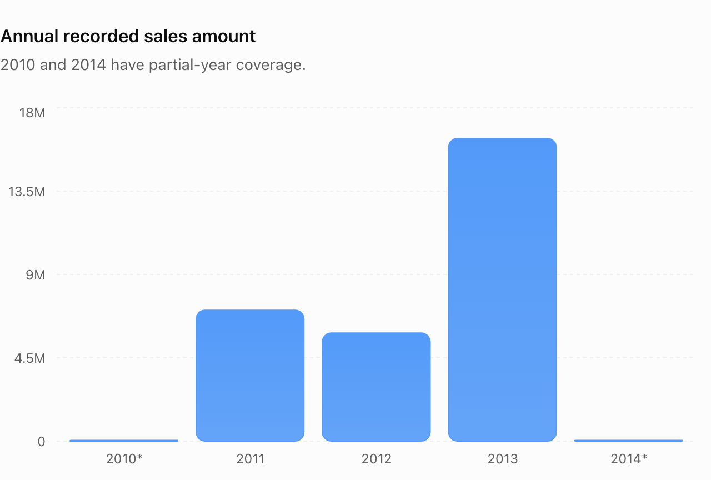

# RetailFlow 360 — Advanced SQL Analytics Notes

## Introduction: Advanced SQL Analytics

SQL analytics can be organized into three major stages:

| Stage | Purpose |
|---|---|
| Data Warehousing | Prepare, clean, integrate, and structure data for analysis |
| Exploratory Data Analysis (EDA) | Understand data structure, dimensions, measures, distributions, and rankings |
| Advanced SQL Analytics | Answer deeper business questions using complex SQL techniques |

RetailFlow 360 uses SQL Server with Bronze, Silver, and Gold layers to support this learning journey.

### Advanced SQL Techniques

- **Window functions:** Perform calculations across related rows without collapsing all rows into one grouped result.
- **Common Table Expressions (CTEs):** Break complex queries into understandable logical stages.
- **Subqueries:** Use one query's result within another query.
- **Advanced aggregations:** Analyze performance across time, groups, and business segments.
- **Stakeholder reporting:** Combine multiple analytical calculations into reusable business reports.

### Advanced Analytics Roadmap

1. Change-over-Time Analysis
2. Cumulative Analysis
3. Performance Analysis
4. Part-to-Whole Analysis
5. Data Segmentation
6. Advanced Business Reporting

These topics will build on the SQL EDA work already completed.

---

# Lesson 01: Change-over-Time Analysis

## Definition

Change-over-time analysis evaluates how a business measure evolves across a date dimension.

**Formula:** Aggregate Measure + Date Dimension = Time-Based Analysis

Examples include total sales by year, order counts by month, and quantities sold over time.

## Why It Matters

This analysis can reveal:

- Long-term growth and declines
- Differences between business periods
- Seasonal patterns
- Changes in customer purchasing activity
- Periods requiring further investigation

## Date Granularity

Granularity defines the level of detail at which time is analyzed.

| Granularity | Meaning |
|---|---|
| Day | One aggregated result per date |
| Year | One aggregated result per calendar year |
| Month of year | January through December, pooled across years |
| Year-month | One result for every individual calendar month |

Year-month is particularly useful for chronological sales trend charts.

## SQL Functions

- `YEAR(date)` extracts the calendar year.
- `MONTH(date)` extracts the month number.
- `SUM(measure)` calculates an aggregate total.
- `COUNT(DISTINCT value)` counts distinct non-NULL values.
- `DATETRUNC(MONTH, date)` produces the start of the month in SQL Server 2022.
- `FORMAT(date, pattern)` creates human-readable text.

Use real dates for chronological sorting and apply text formatting primarily for display.

## RetailFlow 360 Application

The Gold sales view, `gold.fact_sales`, provides:

- `order_date` — time dimension
- `sales_amount` — recorded sales amount
- `quantity` — units sold
- `customer_key` — customer reference
- `order_number` — order identifier

These fields allow us to calculate daily, annual, and monthly sales metrics.

## Data Quality Considerations

Earlier project validation identified 19 sales records with missing order dates.

Those records cannot be assigned to a calendar period without additional information.

When filtering with `WHERE order_date IS NOT NULL`, the time-series total may differ from the overall sales KPI.

The excluded amount should be reported and reconciled.

Also, incomplete first or last years can create misleading apparent growth or decline.

## Key Analytical Distinctions

- Annual sales totals show broad changes but can obscure monthly variation.
- Month-of-year totals combine corresponding months across different years.
- Year-month analysis preserves chronological order.
- Unique purchasing customers are not the same as newly registered or acquired customers.
- A high or low sales month does not automatically establish seasonality.
- Sales amounts should not be assigned a currency unless source documentation supports it.

## Key Takeaway

Change-over-time analysis extends basic SQL aggregations by introducing date-based grouping. It helps analysts understand how business activity develops over time while requiring careful consideration of missing dates, incomplete periods, and aggregation granularity.

**Next lesson:** Cumulative Analysis — running totals and advanced window functions.

---

## Published Lesson 01 — Captured Results and Interpretation

The original learning notes above are preserved. This supplement records the project owner's supplied SQL outputs, not a new execution against the database. Source: **RetailFlow 360 Gold SQL query outputs**. No currency is established for these amounts.

### From Warehousing to Advanced Analysis

Bronze, Silver, and Gold prepare and integrate data. Foundational EDA covers database, dimension, date, measure, magnitude, and ranking exploration. Advanced analytics builds on that understanding with time-based aggregation, window functions, CTEs, subqueries, performance comparisons, customer segmentation, and stakeholder reporting. Only Change-over-Time Analysis is completed in this advanced milestone; cumulative, performance, part-to-whole, segmentation, and advanced business reporting remain upcoming.

**Change-over-Time Analysis = Aggregate Measure + Date Dimension**

The lesson asks how sales change by year, which year has the highest sales, how monthly sales evolve, which months perform best, and how quantities and purchasing customers change across periods. The following distinctions determine which query answers each question.

| Expression or grain | Interpretation | Sorting and comparison |
|---|---|---|
| `order_date` | Daily totals when the underlying column is a date | Sort by the date; timestamp columns would require truncation for daily grain |
| `YEAR(order_date)` | One group per year | Compare complete, comparable periods |
| `MONTH(order_date)` | Pools the same month across all years | Numeric month order; uneven year coverage can bias comparisons |
| `DATETRUNC(MONTH, order_date)` | Keeps year and month in a date value at month start | Preferred chronological grouping and sorting in SQL Server 2022 |
| `FORMAT(order_date, 'yyyy-MMM')` | A display string such as `2013-Jan` | Month-name alphabetical order is not calendar order; sort by the underlying date |

The existing formatting query first aggregates in a CTE, then formats the resulting dates with explicit `en-US` labels while ordering by `sales_month`. `GROUP BY` defines the time grain; `SUM` aggregates sales/quantity; distinct counts count non-NULL customer keys or order numbers. `WHERE order_date IS NOT NULL` removes records that cannot be assigned a period. Annual variants and repeated monthly queries are valid learning examples and have been retained unchanged.

**Purchasing customers** are distinct customers active in a period. **Newly acquired customers** require a defined acquisition event, often first observed purchase or registration, and sufficient history. **Retention** requires following a prior cohort into later periods. A period's distinct customer count does not establish either acquisition or retention. Counts across periods are not additive because the same customer may purchase in multiple periods; changing view-generated keys also require care when comparing snapshots.

### Annual Sales — Recorded Results

| Year | Total Sales | Purchasing Customers | Total Quantity |
|---|---:|---:|---:|
| 2010 | 43,419.00 | 14 | 14 |
| 2011 | 7,075,088.00 | 2,216 | 2,216 |
| 2012 | 5,842,231.00 | 3,255 | 3,397 |
| 2013 | 16,344,878.00 | 17,427 | 52,807 |
| 2014 | 45,642.00 | 834 | 1,970 |

2013 has the highest recorded annual sales at **16,344,878.00**. Using `(current - prior) / prior × 100`, sales declined approximately **17.4%** from 2011 to 2012 and grew approximately **179.8%** from 2012 to 2013.



Source: RetailFlow 360 Gold SQL query outputs. **2010 contains only December and 2014 only January in the supplied results.** Their totals must not be directly compared with full years as evidence of annual performance changes. Complete month coverage in 2011–2013 does not itself prove every source record or day is complete.

### Monthly Sales — Recorded Snapshot

The [monthly CSV](data/monthly_sales_snapshot.csv) preserves all **38 exact supplied year-month sales values**, from December 2010 through January 2014. No missing months or estimated values were inserted. Grouping those values by year reproduces every annual sales total above.


Source: RetailFlow 360 Gold SQL query outputs. The main trend shows **2011–2013**, the three years with all twelve monthly results. The CSV retains both boundary-year observations. December 2013 has the highest recorded monthly sales: **1,874,128.00**. Sales levels generally increased during 2013, with month-to-month declines as well as increases. Compare equivalent periods; a high December does not establish seasonality on its own. January 2014 is not evidence of a full-year business collapse.

### Data Quality and Reconciliation

| Measure | Overall KPI | Dated yearly total | Difference |
|---|---:|---:|---:|
| Sales amount | 29,356,250.00 | 29,351,258.00 | 4,992.00 |
| Quantity | 60,423 | 60,404 | 19 |

The sales and quantity differences are arithmetic checks of the supplied results. Earlier validation reported **19 sales records with NULL order dates**. These differences are consistent with that issue, but the missing-date amounts and row count were **not independently reverified** in this task. Quantity is a unit count, not a row count; the equal values of 19 do not by themselves establish which records account for the discrepancy. Different extraction snapshots could also affect reconciliation.

Records without dates cannot be assigned to yearly or monthly periods. Keep their amounts visible alongside dated totals. Do not delete or impute them to make charts reconcile.

The following read-only check supplements the existing SQL file's reconciliation query; it has not been executed here. Run in `DataWarehouse` only when separately authorized:

```sql
SELECT
    COUNT(*) AS missing_date_records,
    SUM(CAST(sales_amount AS DECIMAL(19,2)))
        AS sales_without_order_date,
    SUM(CAST(quantity AS BIGINT))
        AS quantity_without_order_date
FROM gold.fact_sales
WHERE order_date IS NULL;
```

### January Comparison — Investigation Required

| Metric | January 2013 | January 2014 |
|---|---:|---:|
| Sales | 857,758 | 45,642 |
| Unique Orders | 632 | 871 |
| Purchasing Customers | 627 | 834 |
| Quantity Sold | 1,677 | 1,970 |

January 2014 has higher orders, purchasing customers, and quantity but substantially lower recorded sales than January 2013. Product mix and recorded selling prices are possible explanations, **not verified causes**. Check comparable date coverage, source completeness, and the same warehouse snapshot before attributing a cause.

The corresponding January-specific diagnostic is not in the preserved lesson SQL. This suggested read-only query is documented separately and was not executed:

```sql
SELECT
    YEAR(order_date) AS sales_year,
    SUM(CAST(sales_amount AS DECIMAL(19,2))) AS total_sales,
    COUNT(DISTINCT order_number) AS unique_orders,
    COUNT(DISTINCT customer_key) AS purchasing_customers,
    SUM(CAST(quantity AS BIGINT)) AS quantity_sold
FROM gold.fact_sales
WHERE order_date IS NOT NULL
  AND MONTH(order_date) = 1
  AND YEAR(order_date) IN (2013, 2014)
GROUP BY YEAR(order_date)
ORDER BY sales_year;
```

Follow-up product-level investigation should verify dimension key uniqueness before joining, then compare product quantities and recorded sales per unit. This would test hypotheses; no explanation is established by this milestone.

### Chart Provenance and Reproducibility

The two published PNGs are the owner's downloaded charts, copied without re-encoding. Their coverage, scale, annual bars, and monthly pattern were visually compared with the supplied results; images alone do not provide exact underlying numerical verification. The CSV is the exact numerical reference and reconciles to all annual totals.

The [Matplotlib script](visualizations/generate_sales_trends.py) validates the snapshot and generates equivalent data-driven charts in a separate output directory, preserving the downloaded originals. It uses no database connection, credentials, private row-level data, or automatic refresh. The regenerated charts need not be pixel-identical to the supplied graphics. See the [advanced README](README.md) for the command and dependencies.
