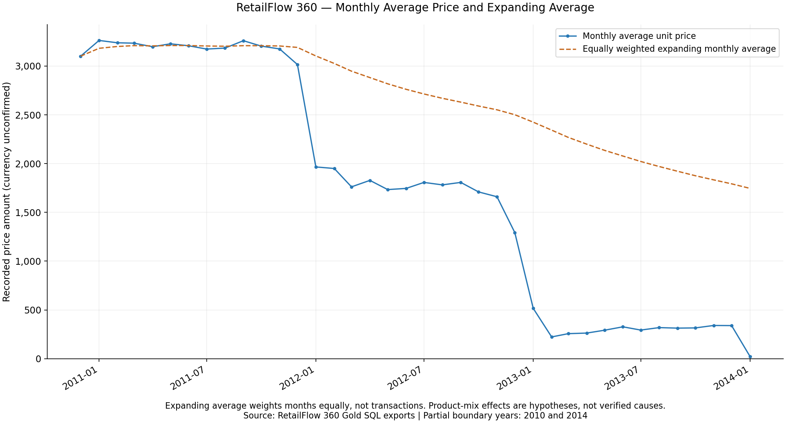

# Advanced SQL Analytics — Lesson 02: Cumulative Analysis

## Introduction

Cumulative analysis progressively aggregates a measure across time. It answers how much has accumulated, while rolling and expanding averages help describe changing levels. This lesson uses the existing read-only [SQL Server 2022 queries](02_cumulative_analysis.sql) against `DataWarehouse.gold.fact_sales`.

| Calculation | Business question | Behavior |
|---|---|---|
| Normal aggregation | How much did each month sell? | GROUP BY collapses sales lines into one row per month |
| Running total | How much has accumulated since the first observed month? | Adds every preceding monthly total and the current total |
| Year-to-date total | How much has accumulated within this calendar year? | Resets at each year boundary |
| Moving average | What is the recent sales level? | Averages the current and previous two available monthly rows |
| Expanding average | What is the average across all months seen so far? | Retains all preceding monthly observations |

## SQL Window Functions

`GROUP BY` changes the result grain by combining input rows. Window functions calculate across related rows while retaining each result row. The CTEs aggregate sales lines first, giving one row per month; the outer queries then operate on those monthly rows.

- `OVER()` defines the set of rows used by a window calculation. Without ordering or partitioning, an aggregate over an empty `OVER()` specification would produce the whole-set total on each row, not a running total.
- `ORDER BY sales_month` inside the window establishes calculation order. The outer `ORDER BY` independently controls displayed row order.
- `PARTITION BY YEAR(sales_month)` creates a separate calculation for each year.
- A window frame specifies which rows within that ordered partition contribute to the current result.
- `UNBOUNDED PRECEDING` starts at the partition's first row; `CURRENT ROW` ends at the current row.
- `2 PRECEDING` starts two rows before the current row, where those rows exist.

For example, `ROWS BETWEEN UNBOUNDED PRECEDING AND CURRENT ROW` makes the cumulative row-by-row intent explicit. It avoids relying on the default peer-sensitive `RANGE` behavior when an ordered aggregate omits its frame. Here the monthly CTE produces unique month values, so there are no date peers, but the explicit frame documents the intended behavior.

`ROWS BETWEEN 2 PRECEDING AND CURRENT ROW` means three available rows, not necessarily three calendar months. These exports have continuous coverage, so rows correspond to adjacent months. If future extracts omit a month, use a defined calendar and an explicit missing-month policy rather than silently treating missing data as zero. The first result averages one row and the second averages two. This window crosses year boundaries because it has no yearly partition.

## Query Walkthrough

### 1. Monthly Sales with Running Total

The business question is how much recorded sales has accumulated over time. The `monthly_sales` CTE groups non-NULL dates with `DATETRUNC(MONTH, order_date)`, casts the resulting month to `DATE`, and sums decimal sales amounts. The outer `SUM(total_sales) OVER (...)` adds all monthly rows through the current month. The month is retained beside its monthly sales and cumulative sales.

At January 2011, 43,419.00 from December 2010 plus 469,795.00 equals 513,214.00. This is an all-period total, not January's own sales and not a total that resets annually.

### 2. Year-to-Date Running Sales

The CTE produces the same monthly totals. Adding `PARTITION BY YEAR(sales_month)` resets the sum for each calendar year. January 2011 therefore has a YTD value of 469,795.00, while its all-period cumulative value is 513,214.00. December 2013 YTD is 16,344,878.00; its all-period cumulative value is 29,305,616.00.

The YTD query was already present and was preserved. A local `YEAR-TO-DATE_RUNNING_SALES.json` export contains 38 rows whose values were checked against independent yearly cumulative sums. This is validation of an existing exported result, not a new SQL execution. The export remains unchanged and outside this commit's dataset scope.

### 3. Moving Average and Cumulative Average

The `monthly_metrics` CTE calculates monthly sales and `AVG(CAST(price AS DECIMAL(18,2)))`. This price measure is an arithmetic mean of non-NULL recorded sales-line prices; it is not automatically quantity-weighted or sales divided by quantity.

The outer three-row `AVG(total_sales)` smooths recent sales fluctuations. The expanding `AVG(average_unit_price)` gives each available monthly average equal weight, regardless of the number of sales lines or units in that month. It is not an overall transaction-weighted average, nor a quantity-weighted price. An overall line-weighted average would require the underlying non-NULL price counts and sums; those counts are not supplied in this snapshot.

All three original query sections and comments are preserved byte-for-byte. Static review found appropriate SQL Server 2022 date aggregation, explicit frames, decimal aggregation, annual partitioning, and read-only Gold references. No SQL was executed during this milestone.

## Actual Business Results

The following values are validated exported SQL results, not illustrative data:

| Month | Monthly sales | All-period running total |
|---|---:|---:|
| Dec 2010 | 43,419.00 | 43,419.00 |
| Jan 2011 | 469,795.00 | 513,214.00 |
| Feb 2011 | 466,307.00 | 979,521.00 |
| Dec 2011 | 669,395.00 | 7,118,507.00 |
| Dec 2012 | 624,454.00 | 12,960,738.00 |
| Dec 2013 | 1,874,128.00 | 29,305,616.00 |
| Jan 2014 | 45,642.00 | 29,351,258.00 |

Total dated sales are **29,351,258.00**. The running total increases monotonically here because every recorded monthly sales amount is positive. An increasing cumulative curve alone does not demonstrate accelerating business growth; inspect monthly increments and comparable periods.

| Metric | December 2013 | January 2014 |
|---|---:|---:|
| Three-month moving-average sales | 1,776,025.666666 | 1,233,486.000000 |
| Average unit price | 339.515942 | 23.168527 |
| Cumulative average monthly price | 1,792.612648 | 1,746.048329 |

The December moving average is approximately **1,776,025.67**. January's is **1,233,486.00**, reflecting November, December, and January observations. December 2010 and January 2014 are partial boundary **years**; the exports alone do not establish complete daily coverage within each month. January 2014 alone does not establish a sustained business decline.

The first monthly average price is 3,101.357142 in December 2010, compared with 23.168527 in January 2014. This notable observed decline requires investigation. Product mix, source coverage, and recorded pricing are possible factors, not established causes; these results do not prove discounts, inflation, or changes in product quality.

### Cumulative Sales Trend


The final annotation identifies 29,351,258 in dated sales. Boundary labels make the partial-year coverage explicit. Amounts have no verified source currency.

### Monthly Sales and Three-Month Moving Average


The rolling line smooths short-term fluctuations. The first two rows use fewer than three observations. The January 2014 observation is shown with a coverage caveat, not interpreted as a full-year result.

### Average Price and Cumulative Average



The expanding line equally weights monthly averages. Differences in product mix could affect the monthly price series, but require further analysis to verify.

## Data Quality and Limitations

The previous overall sales KPI was **29,356,250.00**. Subtracting dated sales of **29,351,258.00** gives **4,992.00**. Earlier work reported 19 records with NULL order dates, which cannot be assigned to a month and are excluded by the SQL's date filter. The numerical difference is consistent with that issue; its attribution was not directly reverified against SQL Server. Reconcile on the same extraction snapshot before asserting that those rows account for the full amount.

Partial years and incomplete observation periods limit comparisons. Missing months would change the meaning of a ROWS-based average. Distinct monthly customers are not additive across months. Missing prices are ignored by SQL AVG, and the distinction between line-, unit-, and month-weighted averages must remain explicit. Currency is unconfirmed.

### Snapshot Provenance and Validation

The [combined CSV](data/cumulative_analysis_snapshot.csv) joins the owner's three local exports by matching chronological month: `monthly_sales_trend.json`, `MONTHLY_SALES_WITH_RUNNING_TOTAL.json`, and `MOVING_AVERAGE_AND_CUMULATIVE_AVERAGE.json`. Each has exactly 38 monthly records from December 2010 through January 2014. Dates were normalized to ISO day format; numeric values retain the exported precision. The source JSON files are preserved locally and are not duplicated into the published dataset.

All dates and monthly sales agree across the three exports and the earlier committed monthly CSV. Python Decimal arithmetic independently verified every running total, rolling sales average, and expanding monthly-price average. Tolerance is **0.000001** for six-decimal averages: the largest rolling difference is approximately 0.000000667 and the largest expanding-price difference approximately 0.000000917. Running totals match exactly. All requested checkpoints match, including the final 29,351,258.00. The extra YTD export also reconciles across all 38 months.

CSV measures are actual exported values. Independent recalculations, percentage interpretations, and graph coordinates are derived checks/presentations; they do not replace the original outputs or represent new database measurements. No source values were corrected.

The [chart generator](visualizations/generate_cumulative_charts.py) validates the CSV before plotting. From the advanced directory, with Python and Matplotlib available:

```bash
python3 visualizations/generate_cumulative_charts.py --output-dir /tmp/retailflow-cumulative-preview
```

Choose a fresh directory: existing chart files are never overwritten. The script reads only the CSV, has no database connection, and does not install packages. It was run using the existing Anaconda Python/Matplotlib environment. The PNGs are static, reproducible snapshots; they do not automatically refresh.

## Interview and Learning Takeaways

- Use GROUP BY to establish the analytical grain before window calculations.
- Use an ordered SUM with an explicit expanding frame for accumulated sales.
- Add yearly PARTITION BY for annual resets, while recognizing partial-year coverage.
- Use a bounded ROWS frame to smooth recent observations, with a missing-month policy.
- Use an expanding AVG for a historical average; explain exactly what each input row represents and how it is weighted.
- Validate exported results with independent arithmetic and retain source provenance.
- Separate increasing totals from growth rates, price patterns from causal explanations, and captured results from live verification.

[Advanced roadmap](README.md) · [Previous lesson](NOTES_CHANGE_OVER_TIME.md)
