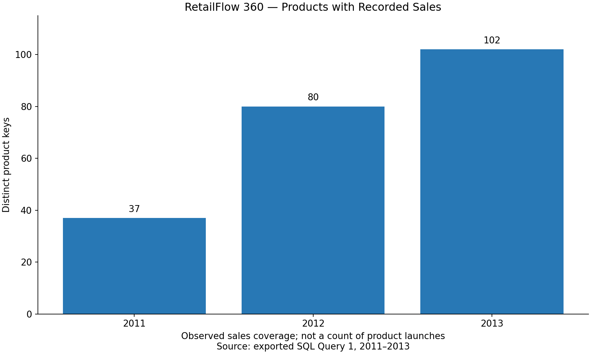
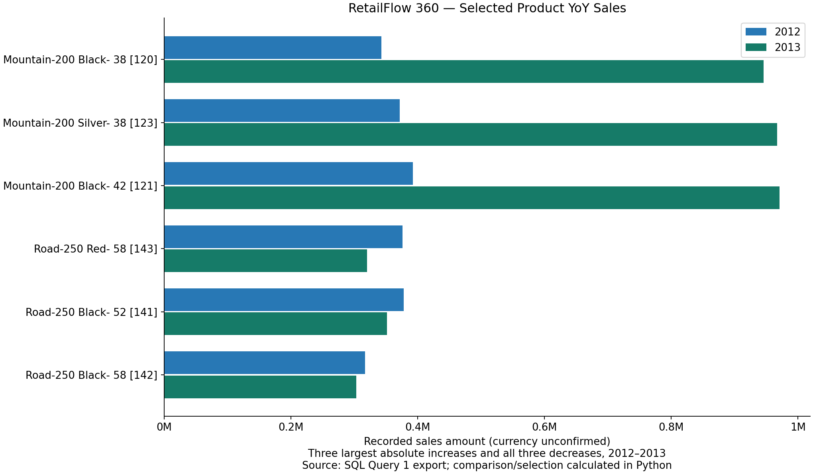
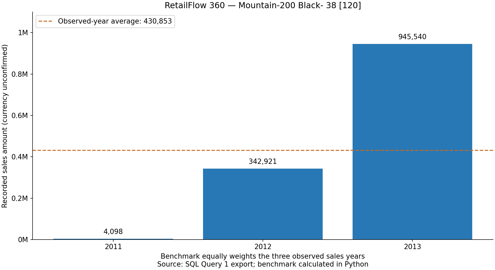

# Advanced SQL Analytics — Lesson 03: Performance Analysis

## 1. Introduction

Performance Analysis compares an observed business measure against a reference value, benchmark, target, or previous period.

**Performance Difference = Current Value − Reference Value**

This case study compares each product's recorded annual sales with its own observed-year average and its previous calendar year's sales. The grain is one product key per calendar year, for 2011–2013. The [SQL lesson](03_performance_analysis.sql) retains the owner's executed Query 1 and appends read-only comparison and summary queries. No database queries were executed during publication.

## 2. Types of Performance Analysis

| Reference | Question | Interpretation |
|---|---|---|
| Average | Is the current value above its usual observed level? | Specify the population and years contributing to the average |
| Minimum or maximum | How far is performance from a recorded low or high? | Extremes depend on the observation window |
| Business target | Are we meeting an agreed goal? | Requires an actual target; none is supplied here |
| Previous year | How does this year compare with the immediately prior year? | Verify consecutive years and comparable coverage |
| Previous month | How does this month compare with the immediately prior month? | Requires monthly data and a calendar-gap policy |

Only observed-year averages and annual comparisons are implemented here. Targets, minimum/maximum benchmarks, and monthly performance comparisons are learning extensions, not verified project results.

## 3. SQL Concepts

A CTE names an intermediate query result for the following statement without creating a stored table. It makes the aggregation, benchmark, and comparison steps readable.

`GROUP BY` collapses source rows to the product-year grain. `PARTITION BY` divides an existing result into calculation groups while keeping each product-year row. For example:

```sql
AVG(current_sales) OVER (PARTITION BY product_key)
```

This gives every observed year for a product the same observed-year average. It does not fill missing product-years with zero. With no window ordering, the average uses the entire product partition rather than an expanding frame.

```sql
LAG(current_sales) OVER (
    PARTITION BY product_key ORDER BY order_year
)
```

This retrieves the preceding available row. Ordering by year is deterministic here because the product-year combination is unique. Retrieve `LAG(order_year)` as well to determine whether the previous available row is actually the previous calendar year.

`CASE WHEN` expresses classification rules. Check absent or nonconsecutive prior years before checking increases or decreases. NULL represents an unavailable comparison; zero is a recorded numeric value. Do not coalesce an absent comparison into zero or classify it as No Change.

Percentage change is `(current − prior) / prior × 100`. `NULLIF(previous_year_sales, 0)` makes a zero denominator NULL, preventing division by zero. In that case the absolute change may still be meaningful, but percentage change is undefined.

## 4. SQL Query Walkthrough

### Query 1 — Yearly Product Sales

The preserved query joins `gold.fact_sales` to `gold.dim_products` using product key, filters dates from January 2011 inclusive through January 2014 exclusive, and groups by calendar year, product key, and product name. Decimal sales are summed to `current_sales`. Product keys prevent equal names from merging unrelated products.

This is an INNER JOIN: unmatched fact references are excluded, and duplicate dimension keys could multiply rows. The exported annual totals reconcile with the prior annual sales results, but that reconciliation is not an independent live check of join uniqueness or referential integrity.

### Query 2 — Compare Against Average

The `yearly_sales` CTE repeats the annual aggregation, and `benchmarks` calculates `AVG(current_sales)` per product. The outer SELECT subtracts the average and labels Above Average, Below Average, or At Average. Products observed for one year have that year's sales as their average; this does not imply stable long-term performance. The benchmark includes the current year and later observed years, so it is a retrospective reference, not a forecast or pre-established target.

### Query 3 — Previous Calendar Year

`prior_observations` retrieves both the previous observed year and sales. `comparisons` exposes prior-calendar-year sales and absolute difference only when the years are adjacent:

```sql
CASE WHEN previous_observed_year = order_year - 1
     THEN previous_observed_sales END AS previous_year_sales
```

The status is No Prior Year for the first observed row; Missing Prior Calendar Year for a gap; otherwise Increase, Decrease, or No Change. Percentage change uses a protected denominator. “No Prior Year” means no prior observation within this filtered dataset, not proof that the product never sold before 2011.

### Query 4 — Summary and Largest Absolute Changes

Summary counts are grouped by comparison year and restricted to consecutive-year pairs. Separate top-five queries rank 2013 absolute increases and decreases, with product key as a deterministic tie-breaker. Only three declines exist in this export, so a top-five decline query would return three rows. Ranking absolute differences avoids selecting products solely for extreme growth from tiny baselines.

Queries 2–4 were added but **not executed**. No genuine Query 2 result export was found in the inspected project or Downloads files. Published benchmark and YoY metrics are **Python calculations based on exported SQL Query 1 results**, not independently executed SQL comparison results.

## 5. RetailFlow 360 Business Results

### Input and Product Coverage

The actual local source is `YEARLY_PRODUCT_SALES.json`. The requested `Pasted text(20261022-212423).txt` was not located in the repository or Downloads. The available JSON matches all expected source checkpoints and was used without inventing additional rows.

| Year | Distinct product keys with recorded sales | Recorded sales |
|---|---:|---:|
| 2011 | 37 | 7,075,088.00 |
| 2012 | 80 | 5,842,231.00 |
| 2013 | 102 | 16,344,878.00 |
| Total | 130 distinct across all years | 29,262,197.00 |

There are **219 product-year records**, no duplicate product-year combinations, and 130 distinct product keys. The yearly product counts sum to 219 observations, not 219 different products. These counts describe sales coverage; they do not independently establish product launches or catalog expansion.



### Consecutive-Year Comparisons

Among **65 products** with recorded sales in both 2012 and 2013, **62 increased, 3 decreased, and 0 were unchanged**. These comparisons cover products observed in both years, not all 102 products observed in 2013. Across the full derived file, 130 first observations have No Prior Year; 89 rows have consecutive comparisons (86 increases, 3 decreases). No observed product history has a year gap, but the implementation explicitly handles that case.

| Declining product | Key | 2012 sales | 2013 sales | Absolute change | Percentage change |
|---|---:|---:|---:|---:|---:|
| Road-250 Red- 58 | 143 | 376,087.00 | 320,033.00 | −56,054.00 | −14.90% |
| Road-250 Black- 52 | 141 | 378,269.00 | 351,792.00 | −26,477.00 | −7.00% |
| Road-250 Black- 58 | 142 | 316,912.00 | 302,932.00 | −13,980.00 | −4.41% |



The chart shows the three largest absolute increases and all three decreases, selected deterministically from validated 2012–2013 pairs. It does not rank percentage changes or imply future sustained growth.

### Mountain-200 Black- 38 — Product Key 120

| Year | Recorded sales | Difference from average | YoY absolute change | Average status |
|---|---:|---:|---:|---|
| 2011 | 4,098.00 | −426,755.00 | Unavailable | Below Average |
| 2012 | 342,921.00 | −87,932.00 | +338,823.00 | Below Average |
| 2013 | 945,540.00 | +514,687.00 | +602,619.00 | Above Average |

The observed-year average is `(4,098 + 342,921 + 945,540) / 3 = 430,853`. AVG OVER supplies this benchmark on each row. LAG supplies 4,098 for the 2012 comparison and 342,921 for 2013, with adjacent-year checks passing. The tiny 2011 starting value makes percentage growth especially sensitive to the baseline; absolute differences provide useful additional context.



### Reproducibility and Numeric Precision

The [processing script](visualizations/generate_performance_data.py) accepts the original JSON (including JSON in a `.txt` file) or the committed [source snapshot CSV](data/yearly_product_sales_snapshot.csv). It validates required fields, identifiers, finite cent-precision sales, years, counts, uniqueness, annual totals, and expected derived checkpoints before writing either dataset. Source rows are sorted by product key and year; values are unchanged.

The [performance snapshot](data/product_performance_snapshot.csv) contains the benchmark, differences, statuses, previous observed values, calendar-safe prior values, and YoY metrics. Empty CSV fields represent NULL/unavailable values. Python Decimal arithmetic computes metrics before rounding derived decimal fields to six places using ROUND_HALF_UP. Classification uses unrounded values. SQL Server's fixed-scale arithmetic may differ in the last decimal place; any future SQL export comparison should allow a documented six-decimal tolerance and investigate larger discrepancies. No claim of executed SQL equivalence is made.

From the advanced directory, with Python and Matplotlib available:

```bash
python3 visualizations/generate_performance_data.py --output-dir /tmp/retailflow-performance-data
python3 visualizations/generate_performance_charts.py --output-dir /tmp/retailflow-performance-charts
```

Choose fresh output directories; existing datasets and charts are not overwritten. The chart script recalculates and validates metrics from the source snapshot using the same processing module. The processing script needs only standard Python; charts use the existing Matplotlib installation. Both ran locally without database access or package installation. The source JSON remains untouched and is not duplicated in the commit. These are static reproducible artifacts, not automatically refreshing dashboards.

## 6. Interpretation and Limitations

- Partial boundary years 2010 and 2014 are excluded. Full calendar-year selection does not guarantee each product had a full year of sales exposure.
- Product-years with no joined transactions are absent; absence is not automatically zero sales, a missing product, or a launch event.
- Unequal observed sales histories make product benchmarks differently constituted. No zero-filled calendar was introduced.
- LAG returns the prior available row; a previous-year label requires a calendar adjacency check.
- The Gold dimension reflects current products rather than full historical as-of-sale attribution. Product mix and data availability can influence comparisons.
- Gold product keys are dynamically generated and should not be treated as immutable business identifiers across warehouse refreshes. This snapshot is internally keyed; cross-snapshot matching needs care.
- INNER JOIN can exclude unmatched facts or multiply sales if dimension keys are not unique. Verify those conditions separately before production reporting.
- Sales amounts have no verified currency. Recorded sales do not establish profit, price changes, demand causes, or customer behavior.
- Large percentage increases from a tiny baseline require caution. No trends are extrapolated beyond the supplied data.

## 7. Interview Takeaways

Establish the product-year grain before calculating windows. Partition by stable-within-snapshot product keys, not names. Distinguish GROUP BY aggregation from row-preserving window functions. Define benchmark membership, time coverage, and weighting. Handle NULL and zero differently, guard denominators, and verify calendar adjacency. Keep observed source results separate from derived metrics and live SQL verification. Reproducible scripts and explicit validation make business claims auditable.

## 8. Key Takeaways

This case study combines joins, CTEs, AVG OVER, LAG, CASE, and protected percentage calculations. All 219 source rows reconcile to 29,262,197 in sales. Among 65 comparable 2012–2013 products, 62 increased and three Road-250 variants decreased. Product 120 illustrates both benchmark and prior-year comparisons. These are descriptive findings; root causes, source completeness, immutable cross-refresh identity, and future SQL/Python output reconciliation remain follow-up work.

[Advanced Analytics README](README.md) · [Previous lesson](NOTES_CUMULATIVE_ANALYSIS.md)
