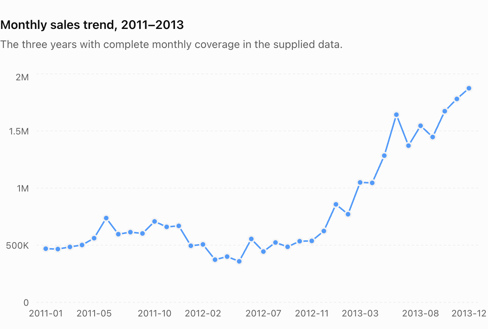
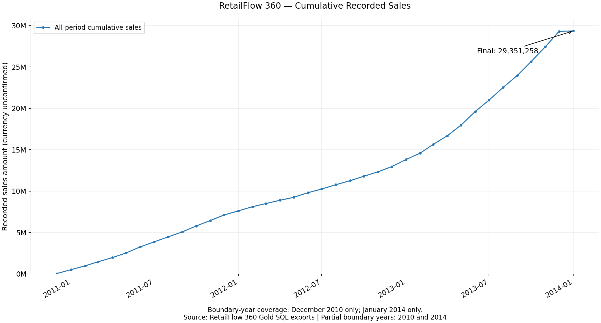
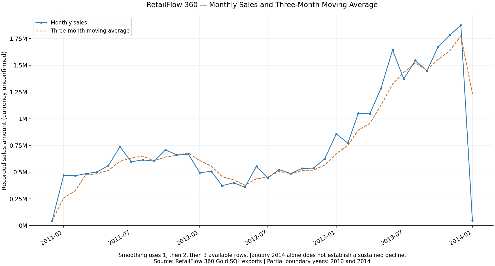

# Advanced SQL Analytics — RetailFlow 360

This phase extends foundational SQL exploration into time-based business analysis, explicit comparisons, segmentation, and stakeholder reporting on the existing Gold views.

## Learning Roadmap

| Lesson | Status | Purpose |
|---|---|---|
| 01 — Change-over-Time Analysis | Completed SQL, notes, captured results, and static visualizations | Compare daily, yearly, pooled month, and chronological monthly measures |
| 02 — Cumulative Analysis | Completed SQL, notes, validated snapshot, and charts | Running totals and cumulative measures |
| 03 — Performance Analysis | Upcoming | Compare periods and reference performance |
| 04 — Part-to-Whole Analysis | Upcoming | Measure contributions to totals |
| 05 — Data Segmentation | Upcoming | Define meaningful business groups |
| 06 — Advanced Business Reports | Upcoming | Combine analyses for stakeholder questions |

## Change-over-Time Analysis

2013 has the highest annual sales (**16,344,878.00**); December 2013 has the highest monthly sales (**1,874,128.00**). Sales grew approximately **179.8%** from 2012 to 2013. The boundary years 2010 and 2014 are partial. Missing order dates affect reconciliation with the overall KPI. No source currency is confirmed, and one high December does not establish seasonality.



Source: RetailFlow 360 Gold SQL query outputs; 2011–2013 have twelve monthly observations each in the supplied snapshot. These are captured results, not newly queried database values.

- [Existing Change-over-Time SQL](01_change_over_time.sql)
- [Learning notes and complete interpretation](NOTES_CHANGE_OVER_TIME.md)
- [Exact monthly snapshot CSV](data/monthly_sales_snapshot.csv)
- [Annual chart — 2010 and 2014 are partial years](images/annual_sales_trend.png)
- [Reproducible Matplotlib script](visualizations/generate_sales_trends.py)

## Reproducibility

The project owner executed the SQL in VS Code and supplied the results. The CSV records those 38 monthly sales values exactly. Annual sums reconcile to 29,351,258.00. Relative to the earlier overall KPI, the sales difference is 4,992.00 and the quantity difference is 19. These are consistent with the previously reported 19 missing-date records, but that attribution requires a direct check against the same snapshot.

The published PNG files preserve the downloaded originals. The Python script validates the CSV's month coverage and annual totals and generates equivalent plots with Matplotlib into a separate directory. It never queries SQL Server. With Python 3 and Matplotlib already available, run from this directory:

```bash
python3 visualizations/generate_sales_trends.py --output-dir /tmp/retailflow-sales-trends
```

The script refuses to overwrite existing chart files. Choose a fresh output directory on later runs. No package installation is performed by the script. The annual plot labels the partial years; the monthly plot uses 2011–2013 and labels amounts without assuming a currency. The CSV retains the partial-year observations for reconciliation.

Static source snapshots, executable SQL lessons, and generated PNG charts are distinct artifacts. Neither the downloaded charts nor this generator automatically refreshes from SQL Server. An interactive dashboard remains future work.

## Upcoming Advanced SQL Analyses

Performance, part-to-whole, segmentation, and business reporting lessons remain planned; no placeholder lesson SQL files are created. Investigate the January 2013/2014 sales-versus-volume contrast and verify missing-date amounts before drawing causal conclusions.

[Return to the analytics roadmap](../README.md)

Validation environment: the generator was successfully run with the existing Anaconda Python and Matplotlib; no dependencies were installed. The original SQL was statically reviewed and was not executed during publication.


## Lesson 02: Cumulative Analysis

Running totals, annual resets, rolling sales averages, and expanding monthly-price averages build on Lesson 01. All 38 monthly records reconcile: final dated cumulative sales are **29,351,258.00**. The three-month sales average is approximately **1,776,025.67** in December 2013 and **1,233,486.00** in January 2014. Boundary years are partial; source currency is unconfirmed.

- [Preserved cumulative SQL](02_cumulative_analysis.sql)
- [Cumulative Analysis notes](NOTES_CUMULATIVE_ANALYSIS.md)
- [Validated combined snapshot](data/cumulative_analysis_snapshot.csv)
- [Reproducible chart generator](visualizations/generate_cumulative_charts.py)





These static charts are generated from exported SQL results. The earliest rolling averages use fewer than three observations; January 2014 alone does not establish a sustained decline. The notes also include the monthly-price chart and explain why an equally weighted average of monthly prices differs from a transaction-weighted average.

Run `python3 visualizations/generate_cumulative_charts.py --output-dir /tmp/retailflow-cumulative-preview` with an existing Matplotlib installation and a fresh output directory. No database connection or automatic refresh is involved.
