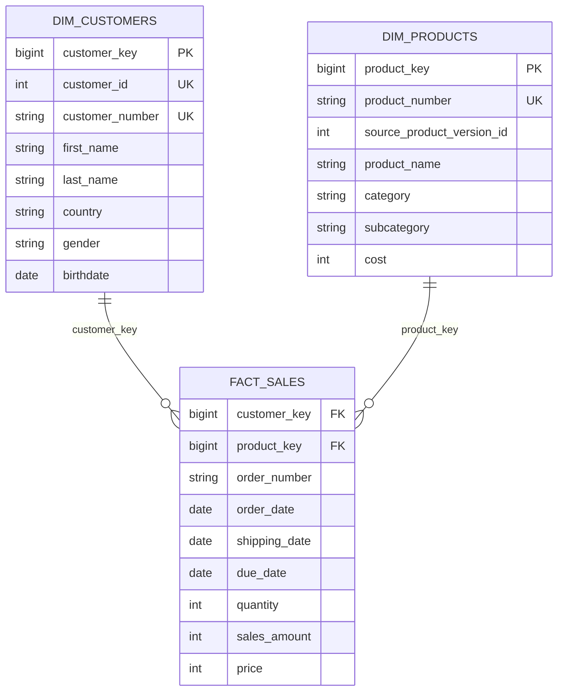
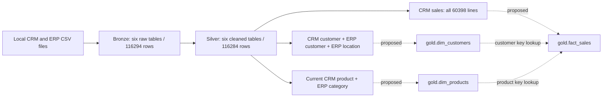

# Gold Phase 1 — proposed logical model

> **Current deployment status (verified locally):** all three Gold objects are SQL
> views: 18,484 customers, 295 products and 60,398 sales. The approved deployment
> and full validation have completed. Statements below describing “prepared”,
> “absent” or “awaiting approval” record the earlier design/preview stage.
> Silver still runs `silver.refresh_all`; the local `silver.load_silver` revision
> remains undeployed and has only offline checks. No ETL was run for this audit.

Status: **instructor-aligned virtual star schema prepared; no Gold DDL executed**.
The active exact column contract is [DATA_DICTIONARY.md](DATA_DICTIONARY.md); see
[reference comparison and preview](INSTRUCTOR_ALIGNMENT.md). Earlier historical
alternatives below are design context, not additional view columns.
The customer view now follows the exact ten-column instructor contract in
[CUSTOMER_DIMENSION.md](CUSTOMER_DIMENSION.md). Gold has no separate ETL loader. Evidence: read-only local Docker
DataWarehouse profile, SQL Server timestamp 2026-10-19 21:56:18. No Gold objects
were returned. No Bronze/Silver changes or pending Silver procedure deployment
were performed. The instructor conventions supplied by the user guide this
proposal; no instructor Gold implementation has been copied.

## Business objects and source evidence

Customer describes who purchases, product describes what is purchased, and sales
records the measurable order-line event. CRM is the customer/product/sales backbone;
ERP enriches customer demographics/location and product classifications.

| Silver source | Rows | Observed keys and grain |
|---|---:|---|
| crm_cust_info | 18,484 | Unique cst_id and cst_key; one CRM customer |
| erp_cust_az12 | 18,484 | Unique cid; one demographic record per customer |
| erp_loc_a101 | 18,484 | Unique cid; one current country per customer |
| crm_prd_info | 397 | Unique prd_id; 295 prd_key values; product version |
| erp_px_cat_g1v2 | 37 | Unique id; category/subcategory classification |
| crm_sales_details | 60,398 | Unique (sls_ord_num, sls_prd_key) in this snapshot |
| Total | 116,284 | Source table rows, not business object count |

All checked identifier fields are non-NULL. SQL metadata shows 39 nullable Silver
columns, INT amounts/IDs, NVARCHAR(50) strings, DATE business dates and DATETIME2
load timestamps. There are no unique indexes/primary keys or foreign keys returned
for Silver: the observed relationships are validated data properties, not database
constraints. Future loads must revalidate them.

There are 27,659 orders, 60,423 units and 29,356,250 total sales amount (currency not
specified). Order number alone is not a fact key. A repeated product on separate
lines of a future order would invalidate the current candidate composite key;
obtain a source line identifier before accepting such data rather than deduplicating.

CRM genders: Male 7,067; Female 6,848; n/a 4,569. Countries: United States 7,482;
Australia 3,591; United Kingdom 1,913; France 1,810; Germany 1,780; Canada 1,571;
n/a 337. Birthdates range 1916-02-10–1986-06-25, with 16 NULL and 22 over 100 years
old at the profile date. Retain those dates; do not apply a new age exclusion.
Product-version lines: Road 162, Mountain 112, Other Sales 54, Touring 52, n/a 17.

| Order year | Sales rows | Sales amount |
|---|---:|---:|
| Unknown | 19 | 4,992 |
| 2010 | 14 | 43,419 |
| 2011 | 2,216 | 7,075,088 |
| 2012 | 3,397 | 5,842,231 |
| 2013 | 52,782 | 16,344,878 |
| 2014 | 1,970 | 45,642 |

## Recommended initial star: current-product perspective

Recommend the instructor-style current-product dimension for the first Gold model,
with explicit current-state semantics. This joins every sale to exactly one current
product and preserves the full fact grain. It does **not** claim product cost or
classification was historically valid on the sale date. Keep product history in
Silver for a separately reviewed historical extension.

- **dim_customers:** one integrated customer; candidate PK customer_key; unique
  customer_id and customer_number. Sources: all three customer/location tables.
- **dim_products:** one current product (prd_end_dt IS NULL); candidate PK
  product_key; unique product_number. Sources: CRM products and ERP categories.
- **fact_sales:** one source order/product line; candidate PK sales_key; alternate
  unique key (order_number, source_product_number). Many-to-one logical FKs
  customer_key → dim_customers and product_key → dim_products. Order number is a
  degenerate dimension. Keep the three DATE columns; a date dimension is out of scope.

Expected customer view rows: 18,484. Proposed current-product view rows: 295.
No fabricated unknown customer row or physical constraints are part of this phase.
Future missing fact-reference handling needs review before product/fact work.

Active architecture: SQL views over Silver. Customer keys use ROW_NUMBER() OVER
(ORDER BY ci.cst_id), dynamically recomputed and potentially renumbered when the
population changes. customer_id and customer_number preserve source identity.
Keys/relationships in the diagram are logical, not enforced constraints. No customer
unknown member is added. Product/fact view key decisions remain for later phases.
Persistent IDENTITY keys and INSERT-based loading are an optional future design,
archived in [the physical proposal](optional_physical/PROPOSAL.md), never implemented.

Conceptual cardinality: a customer places sales lines, and a product appears on
sales lines. Each fact references one customer and one product, including an explicit
unknown member if needed. ERP is flattened into dimensions, not joined directly
to facts and not exposed as additional snowflake dimensions in this proposal.

## Customer integration and precedence

Join cst_key = erp_cust_az12.cid = erp_loc_a101.cid. The joined result is 18,484 rows,
with zero missing matches or reverse ERP orphans. Use LEFT JOIN from CRM regardless,
so a future missing ERP record cannot discard a customer. Gate ERP key uniqueness
before joining; multiple enrichment matches must stop implementation, not fan out.

Proposed gender rule: use known CRM Male/Female first; otherwise known ERP value;
otherwise n/a. ERP would fill 4,554 of 4,569 CRM unknowns, leaving 15 unknowns.
There are 57 disagreements where both systems are known. Report disagreements in separate quality queries; CRM precedence is a **proposed business assumption**, not an
established truth. Do not change Silver to enforce this Gold presentation choice.
Country and birthdate come from ERP; marital status, names and registration date
come from CRM. These are current attributes, not historically tracked demographics.

## Product/category discrepancy

LEFT JOIN CRM cat_id to ERP id. Seven current products have unmatched CO_PE;
ERP CO_PD is the sole unused classification, with Components / Pedals / No.
The seven names are LL/ML/HL Mountain Pedal, LL/ML/HL Road Pedal and Touring Pedal
(product numbers PD-M282, PD-M340, PD-M562, PD-R347, PD-R563, PD-R853, PD-T852).
All start 2013-07-01, all are current, and none has sales in this snapshot.

The shared pedal meaning strongly suggests a coding discrepancy, but does not
prove the intended crosswalk. Default: retain source_category_id=CO_PE, expose
category/subcategory/maintenance as unknown, reported as unmatched in quality checks.
Do not remove these products with INNER JOIN, or silently rewrite Silver codes.
If the owner approves CO_PE → CO_PD, implement a documented Gold mapping with
source and resolved category IDs retained and mapping status APPROVED_CROSSWALK.
Do not infer joins from similar names automatically. 36 of the 37 ERP category IDs are used by CRM; one is unused. No category dimension is required for the initial star.

## Historical products: alternatives and implications

397 versions cover 295 products: 218 have one version, 52 have two, 25 have three.
There are 295 open/current and 102 closed versions, start dates 2003-07-01–2013-07-01.
No NULL starts or reversed ranges were found; each product has exactly one current
version. Silver rebuilt end dates using the next start minus one day; these are
inferred effective intervals, not proof of source historical accuracy.

| Approach | Grain / real members | Benefit | Limitation |
|---|---|---|---|
| Current product (recommended phase 1) | Product / 295 | Simple joins; all 60,398 sales match once | Restates historical product attributes using current values |
| Version-aware product | Product version / 397 | Date-valid attributes for 41,969 sales | 18,410 precede history; 19 have no order date |

A business-key-only join to all versions produces **89,818 rows**, an inflation of
29,420. Strict inclusive order_date BETWEEN start/end (NULL end open) produces
41,969 exact single-version matches and no ambiguous matches; 18,429 rows have no
match: 18,410 BEFORE_HISTORY and 19 UNKNOWN_DATE. An INNER temporal join loses them.

For a future historical model, add product_version_key (surrogate), source version
ID, valid_from, valid_to, is_current, unique (product_number, valid_from), and a
non-overlap gate. Keep one fact per source line using LEFT temporal matching and
require match cardinality ≤1. Unmatched history should reference an explicit
unknown-version member, retain source_product_number and a match-status field;
never backdate the first version or use shipping date as order date silently.
Per-product unknown-version members could retain product identity at the cost of
extra dimension rows. Using earliest/current versions as fallbacks is a separate
business decision and must carry an imputation flag. Do not call fallback matches
historically valid. The instructor fact has no historical_match_status column; separate quality reports
preserve visibility of these temporal limitations.

## Fact preservation and acceptance criteria for later implementation

1. Profile in a stable source snapshot or controlled no-writer window; the current
   audit used separate read-only queries, not a cross-query transactional snapshot.
2. Enforce unique dimension lookup keys before enrichment; exactly one current
   version per product. Abort on duplicate matches, do not DISTINCT away symptoms.
3. LEFT JOIN from all 60,398 sales, preserving source IDs and order/product grain.
   Resolve missing references to explicit unknown members and report them.
4. Reconcile source and fact row multisets at business grain: 60,398 rows, 27,659
   orders, 60,423 units, sales amount 29,356,250; zero duplicate candidate keys.
   Compare every source line's dates and measures, not just totals.
5. Assert no NULL FK values, zero missing dimension references, positive monetary
   values/quantities and sales_amount=quantity*unit_price. Unit price is not additive.
6. Preserve 19 NULL order dates and their 4,992 sales amount; no invented dates.
   Report BEFORE_HISTORY=18,410, UNKNOWN_DATE=19, WITHIN_HISTORY=41,969.
7. Verify customer enrichment remains 18,484 and current product enrichment 295,
   with seven unmatched categories unless an explicit mapping is approved.
8. Keep Silver's 35 monetary corrections traceable through source business keys to
   Silver and Bronze; no extra monetary repair in Gold. Currency and refund semantics
   remain unconfirmed. Current product cost must not be treated as historical COGS;
   margin reporting needs a separately approved costing policy.

## Proposed data flow

Solid paths describe existing layers or source groupings. Dashed paths are proposed
Gold processing. Define customer/product views before dependent fact views; no separate Gold load.
The existing Python Bronze ingestion and transactional Silver pipeline remain intact.

Review decisions: current versus historical product perspective; future product/fact view key policy; CRM gender precedence; approved category
crosswalk versus explicit unknown classification; unknown-member conventions;
currency/refund and historical-cost semantics. See [data dictionary](DATA_DICTIONARY.md)
and [read-only evidence](PROFILE_RESULTS.txt). No implementation is authorized here.
